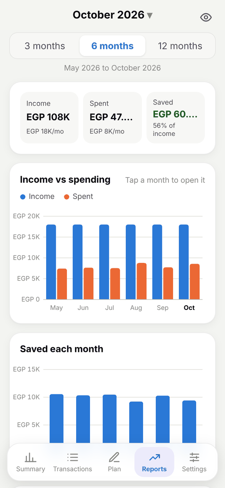
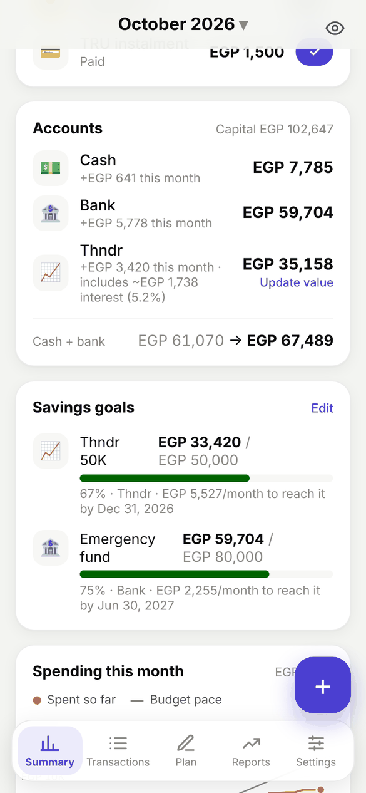
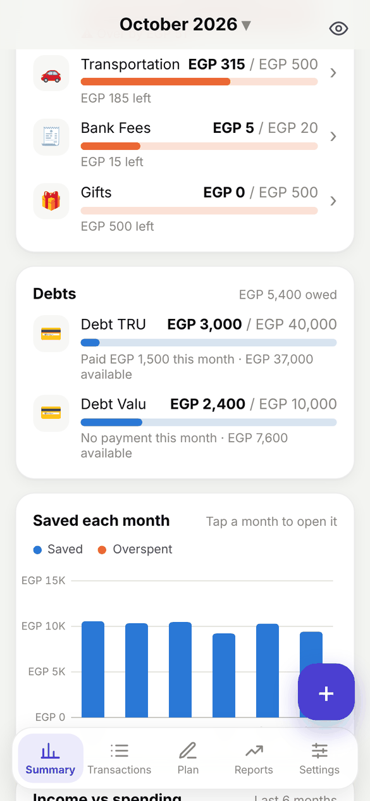
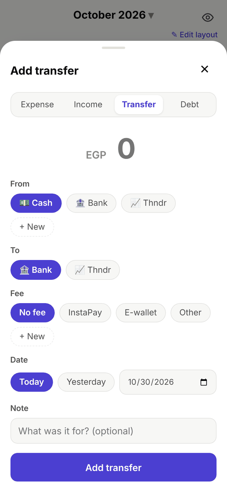
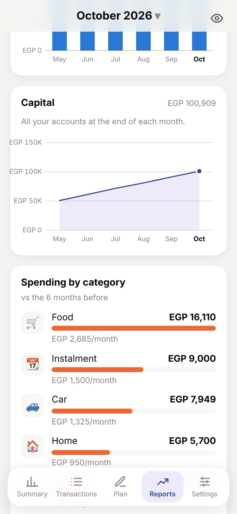
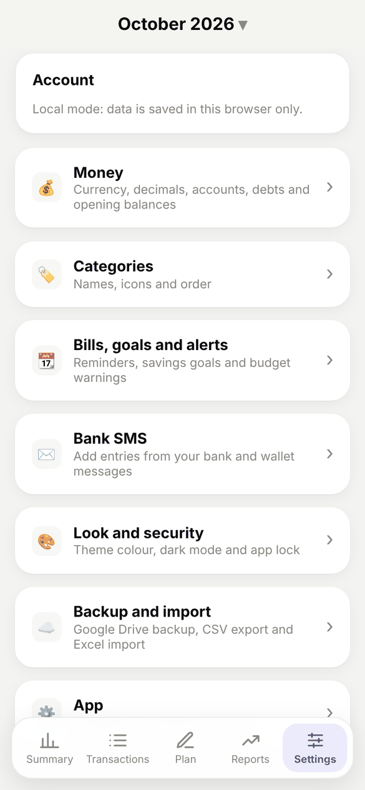
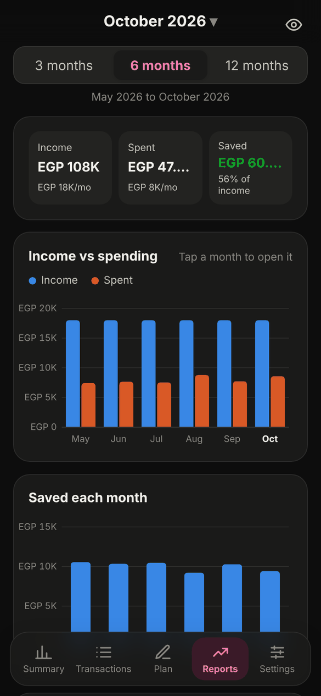

<div align="center">


# Monthly Budget

**Plan your month, track every pound, and see where your money went.**

An Android, Galaxy Watch and web app for monthly budgeting, built around the accounts,
debts and categories of a real "Monthly budget" Google Sheet.

[](https://github.com/0XZEROX0/monthly-budget/releases/latest/download/monthly-budget.apk)
[](https://0xzerox0.github.io/monthly-budget/)

[](https://github.com/0XZEROX0/monthly-budget/actions/workflows/android.yml)
[](https://github.com/0XZEROX0/monthly-budget/actions/workflows/deploy.yml)

&nbsp;
&nbsp;


</div>

> Screenshots use made-up demo data.

## Contents

- [Features](#features)
  - [Phone and web app](#phone-and-web-app)
  - [Galaxy Watch app](#galaxy-watch-app)
- [Screenshots](#screenshots)
- [Install](#install)
- [Tech stack](#tech-stack)
- [Development](#development)
- [Android app](#android-app)

## Features

### Phone and web app

#### 📊 Summary

| | |
|---|---|
| **Left to spend** | A budget ring, income vs spent, how much you saved this month, and a spending pace line against your budget. |
| **Accounts** | Cash, Bank, e-wallets, Thndr and any account type you add. Thndr and other investments show their expected interest, with an "Update value" button. |
| **Where your money went** | Every category against its budget. Tap one to see just its transactions. |
| **Debts** | Lenders with limits (TRU, Valu…). Borrowing raises what you owe, and repayments count toward your Instalment budget. |
| **Trends** | Saved each month and income vs spending over the last six months. Tap a month to open it. |
| **Your layout** | Edit layout lets you hold and drag the Summary's cards into any order and hide the ones you don't need. It syncs across devices. |

#### 💸 Adding money in and out

| | |
|---|---|
| **Expenses, income, transfers and debts** | One add form with big category icons. Transfers move money between accounts without counting as spending. |
| **Transfer fees** | InstaPay (0.1%, EGP 0.5 to 20), e-wallet (1%), a typed fee, or your own fee templates. The fee and total show live as you type, and the fee is saved as its own expense. |
| **Quick add** | Add a new account or category straight from the add form. |
| **Transactions** | Grouped by day, with search and All / Spent / Income / Moves filters. |

#### 📝 Planning and staying on track

| | |
|---|---|
| **Budget plan** | Planned spending per category for each month. It saves as you type, and one tap copies last month's plan. |
| **Bills and reminders** | Instalments (TRU, Valu) remind you every day from the due day for as many days as you choose; a bank or credit card reminds you on its day. Mark them paid from the Summary. |
| **Savings goals** | Targets on any account (e.g. Thndr 50K by December), with an optional deadline and how much to put away each month to reach it. |
| **Budget alerts** | A card and a notification when a category reaches 80% of its budget (adjustable), and again when it goes over. |
| **Reports** | 3, 6 or 12 months of income vs spending, saved each month, capital over time, and spending by category against the period before. |

#### 📩 Bank SMS (Android)

| | |
|---|---|
| **Egyptian banks and e-wallets** | Reads card and transfer SMS from CIB and other Egyptian banks, any sender that shows a masked card, and e-wallets (Vodafone Cash, Orange Cash, Etisalat Cash, WE Pay, InstaPay, Telda). |
| **Pending review** | Nothing is added on its own: each message waits under Transactions › Pending so you check it and pick a category. Entries already in the budget are skipped, and merchants remember their last category. |
| **Notifications** | A notification when a bank SMS arrives, even with the app closed. |

#### 🎨 Make it yours

| | |
|---|---|
| **Themes** | Seven accent colours, plus light, dark or follow the system. |
| **Categories and icons** | Rename categories, accounts and debts and pick their icons; past entries, bills and goals follow the new name. Hold and drag to reorder categories. |
| **Decimals** | Show amounts with two decimals or as whole numbers. |
| **Organised Settings** | Settings grouped into Money, Categories, Bills goals and alerts, Bank SMS, Look and security, Backup and import, and App. |

#### 🔒 Privacy, safety and sync

| | |
|---|---|
| **Privacy mode** | One tap on the eye hides balances and totals, handy in public. |
| **App lock** | Fingerprint or the phone's PIN to open the Android app. |
| **Sync and offline** | Sign in with Google to sync phone, watch and web through Firebase. Works offline too. |
| **Backup and export** | Back up everything to Google Drive (through Android's share menu), export transactions as CSV, and restore from a backup. |
| **Import** | Past months from the "Monthly budget" Google Sheet (.xlsx), or one-row-per-entry exports from other apps like Money Manager. |

#### 📱 On your phone

| | |
|---|---|
| **Home screen widget** | Left to spend this month and a + button that opens the add form. |
| **In-app updates** | Small web updates apply instantly and new APKs download inside the app. A popup at launch and a notification say when a new build is out. |

### Galaxy Watch app

A Wear OS companion made for the Galaxy Watch 8 (any Wear OS 3+ watch works). See the
[watch guide](docs/watch.md) for install steps.

| | |
|---|---|
| **Pages like the phone** | Swipe between Summary, Transactions, Accounts (balances and goals), Reports and Settings. |
| **Quick add** | Add expense or income on a keypad, pick the account and tap a category, in the same order and icons as the phone. |
| **Favorites** | Hold a recent entry to pin it, then tap it to save it again. |
| **Daily allowance** | "≈ X a day" for the rest of the month, and a warning when a category or the month goes over budget. |
| **Bills and goals** | Bills due this month (tap to pay) and savings goal progress. |
| **Tile and complication** | Left to spend on a tile with − and + buttons, and as a watch face complication. |
| **Tap to hide** | Tap the big number to hide amounts on the watch, tile and complication. It follows the phone's eye too. |
| **Works on its own** | Talks to Firestore directly, so entries land even with the phone app closed and wait offline until the watch is back online. It also updates itself. |

## Screenshots

<table>
  <tr>
    <td align="center"><br /><sub><b>Accounts and savings goals</b></sub></td>
    <td align="center"><br /><sub><b>Where your money went</b></sub></td>
    <td align="center"><br /><sub><b>Debts and saved each month</b></sub></td>
  </tr>
  <tr>
    <td align="center"><br /><sub><b>Transactions</b></sub></td>
    <td align="center"><br /><sub><b>Add an expense</b></sub></td>
    <td align="center"><br /><sub><b>Transfer with fees</b></sub></td>
  </tr>
  <tr>
    <td align="center"><br /><sub><b>Budget plan</b></sub></td>
    <td align="center"><br /><sub><b>Capital and spending by category</b></sub></td>
    <td align="center"><br /><sub><b>Settings</b></sub></td>
  </tr>
  <tr>
    <td align="center"><br /><sub><b>Reports in dark mode</b></sub></td>
    <td align="center"><br /><sub><b>Privacy mode (teal theme)</b></sub></td>
    <td></td>
  </tr>
</table>

## Install

**Android:** download the [latest APK](https://github.com/0XZEROX0/monthly-budget/releases/latest/download/monthly-budget.apk) and open it. You may need to allow installs from your browser, and because the app reads bank SMS, Play Protect may warn about it.

**Galaxy Watch:** download the [watch APK](https://github.com/0XZEROX0/monthly-budget/releases/download/wear/monthly-budget-watch.apk) and follow the [watch guide](docs/watch.md) to install it once with adb. After that it updates itself.

**Web:** open [0xzerox0.github.io/monthly-budget](https://0xzerox0.github.io/monthly-budget/) on any device. It can be installed from the browser menu as an app (PWA).

## Tech stack

- [React](https://react.dev) + [TypeScript](https://www.typescriptlang.org), built with [Vite](https://vite.dev) as an installable PWA
- [Firebase](https://firebase.google.com): Google sign-in and Firestore with offline cache
- [Capacitor](https://capacitorjs.com) for the Android app, with native plugins for SMS reading and updates
- [@capgo/capacitor-updater](https://github.com/Cap-go/capacitor-updater) (self-hosted) for web updates inside the app
- Kotlin and Compose for Wear OS for the Galaxy Watch app (`wear/`), with a tile and a complication
- GitHub Actions: deploys the web app to GitHub Pages and builds the phone and watch APKs on every push to `main`

## Development

```sh
npm install
npm run dev        # local dev server
npm run build      # production build in dist/
npm run lint       # oxlint
npm run test:sms   # bank SMS parser tests
```

### Sync with Firebase

With Firebase configured, you sign in with Google and data is stored in Firestore under
`users/{uid}`, syncing live across devices and working offline. Without Firebase config the
app runs in local mode (this browser only).

1. Create a Firebase project and enable **Authentication › Google** and **Firestore**.
2. Copy `.env.example` to `.env` and fill in the web app config. `.env` is not committed: the GitHub
   Actions builds write it from the `FIREBASE_ENV` repository secret, which holds the whole file.
3. Deploy `firestore.rules` so each user can only access their own data.

## Android app

The `android/` folder wraps the same web app with Capacitor. GitHub Actions
([`android.yml`](.github/workflows/android.yml)) builds the APK on every push; on `main` it
replaces the `android` release, so the latest APK is always at
[releases/latest/download/monthly-budget.apk](https://github.com/0XZEROX0/monthly-budget/releases/latest/download/monthly-budget.apk).

<details>
<summary><b>How bank SMS, sign-in and signing work</b></summary>

- **Bank SMS.** The app reads card and transfer messages from the bank senders picked in
  Settings › Bank SMS (`SmsReaderPlugin.java`), parses them in `src/data/smsParser.ts`, and
  lists them under Transactions › Pending until each is reviewed. `SmsReceiver.java` raises a
  notification when one arrives with the app closed. Check the parser with `npm run test:sms`.
- **Sign-in.** Google blocks its sign-in page inside app WebViews, so the app opens the
  website at `?app-signin` in the browser, which signs in and returns the Google ID token
  through `monthlybudget://signin`.
- **Signing.** Builds use the committed `android/app/shared-debug.keystore` so each APK
  installs over the last. To use a private key instead, add the repository secrets
  `ANDROID_KEYSTORE_BASE64`, `ANDROID_KEYSTORE_PASSWORD`, `ANDROID_KEY_ALIAS` and
  `ANDROID_KEY_PASSWORD` (the app must then be reinstalled once).

</details>

To build locally: `npm run build && npx cap sync android`, then open `android/` in Android Studio.
