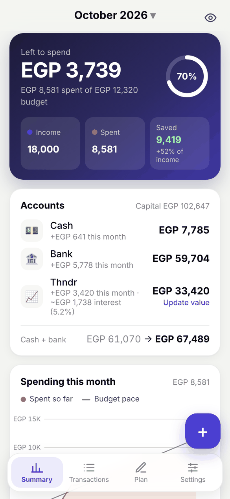
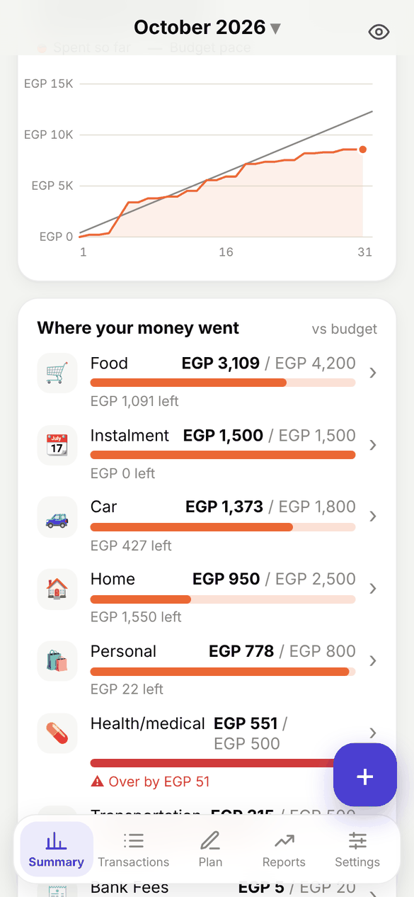
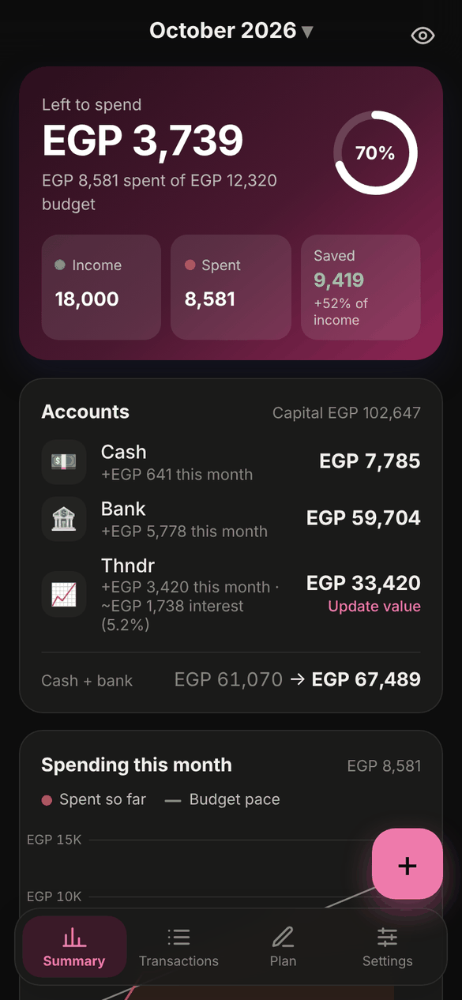
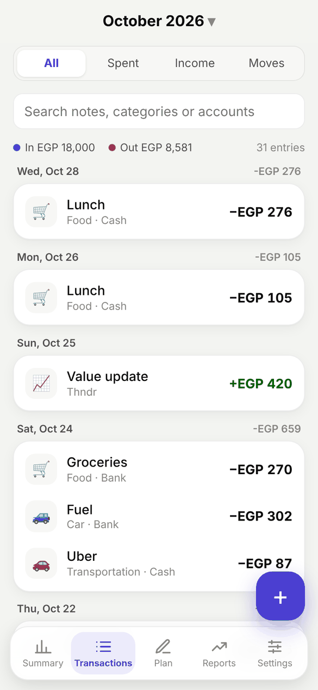
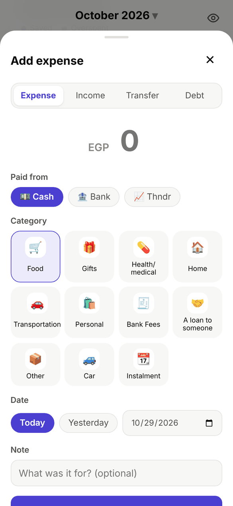
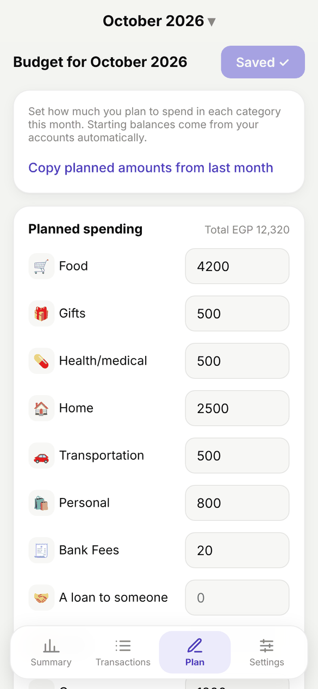
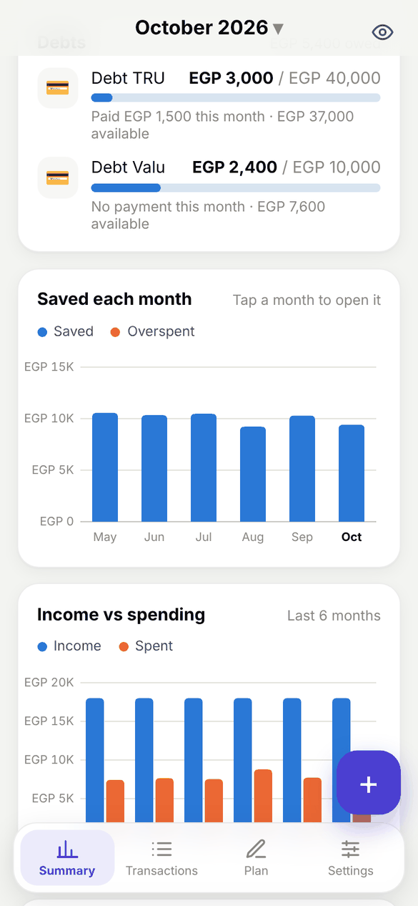
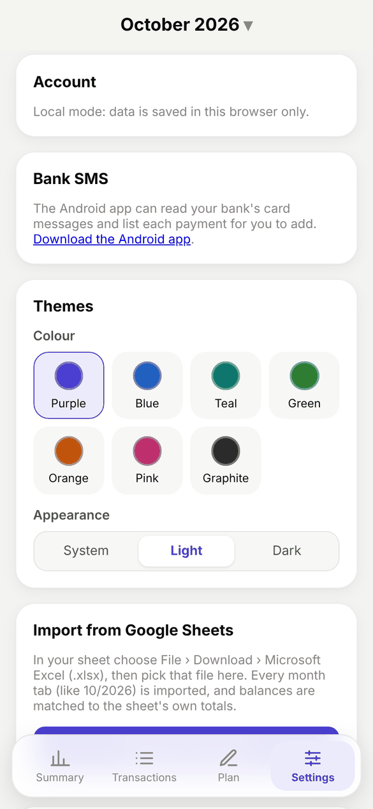
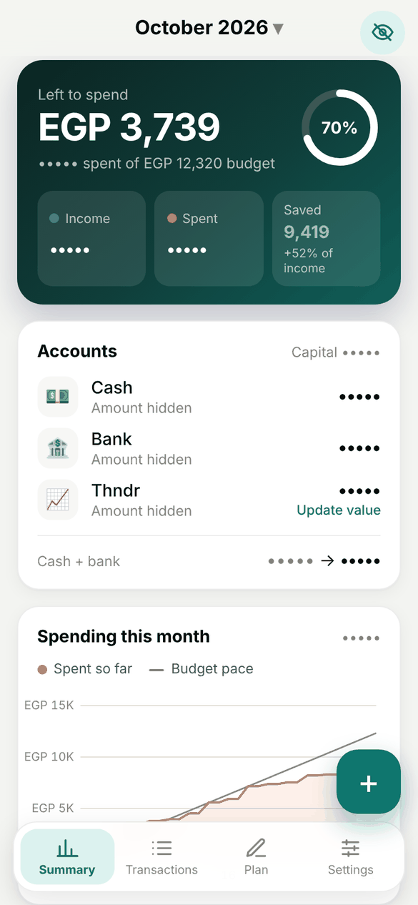

<div align="center">


# Monthly Budget

**Plan your month, track every pound, and see where your money went.**

An Android and web app for monthly budgeting, built around the accounts,
debts and categories of a real "Monthly budget" Google Sheet.

[](https://github.com/0XZEROX0/monthly-budget/releases/latest/download/monthly-budget.apk)
[](https://0xzerox0.github.io/monthly-budget/)

[](https://github.com/0XZEROX0/monthly-budget/actions/workflows/android.yml)
[](https://github.com/0XZEROX0/monthly-budget/actions/workflows/deploy.yml)

&nbsp;
&nbsp;


</div>

> Screenshots use made-up demo data.

## Contents

- [Features](#features)
- [Screenshots](#screenshots)
- [Install](#install)
- [Tech stack](#tech-stack)
- [Development](#development)
- [Android app](#android-app)

## Features

| | |
|---|---|
| 📊 **Monthly summary** | Left to spend, a budget ring, income vs spent, how much you saved, and a spending pace line against your budget. |
| 📝 **Budget plan** | Planned spending per category for each month, with one tap to copy last month's plan. |
| 💸 **Transactions** | Expenses, income and transfers grouped by day, with search and All / Spent / Income / Moves filters. |
| 🏦 **Accounts** | Cash, Bank and Thndr. Transfers move money between them without counting as spending, and Thndr shows estimated interest (5.2%) with an "Update value" button. |
| 💳 **Debts** | Lenders with limits (e.g. TRU, Valu). Borrowing raises what you owe, repayments count toward your Instalment budget. |
| 🔎 **Category drill-down** | Tap any category on the Summary to see just its transactions. |
| 📆 **Bills and reminders** | Instalments (TRU, Valu) remind you every day from the due day for as many days as you choose; a bank or credit card reminds you on its one day. Mark them paid from the Summary. |
| 🎯 **Savings goals** | Targets for bank and investment accounts (e.g. Thndr by the end of the year), with an optional deadline and how much to put away each month. |
| ⚠️ **Budget alerts** | A card and a notification when a category reaches 80% of its budget (adjustable), and again when it goes over. |
| 📈 **Reports** | 3, 6 or 12 months of income vs spending, saved each month, capital over time, and spending by category against the period before. |
| 💾 **Backup and export** | Back up everything to Google Drive (through Android's share menu), export transactions as CSV, and restore from a backup. |
| 🔒 **App lock** | Fingerprint or the phone's PIN to open the Android app. |
| 🏠 **Home screen widget** | Left to spend this month and a + button that opens the add form. |
| 📩 **Bank SMS import** | On Android, reads card and transfer SMS from Egyptian banks (CIB and others) and holds each one under **Pending** so you review it and pick a category before it is added. |
| 🎨 **Themes** | Seven accent colours, plus light, dark or follow-the-system. |
| 🙈 **Privacy mode** | One tap on the eye hides balances and totals, handy in public. |
| 🔄 **In-app updates** | The Android app updates itself: small web updates apply instantly, new APKs download inside the app. A popup at launch and a notification say when a new build is out. |
| ☁️ **Sync and offline** | Sign in with Google to sync across phone and web through Firebase. Works offline too. |
| 📥 **Google Sheets import** | Import past months from the sheet's .xlsx export, reconciled against the sheet's own totals. |

## Screenshots

<table>
  <tr>
    <td align="center"><br /><sub><b>Transactions</b></sub></td>
    <td align="center"><br /><sub><b>Add an expense</b></sub></td>
    <td align="center"><br /><sub><b>Budget plan</b></sub></td>
  </tr>
  <tr>
    <td align="center"><br /><sub><b>Debts and trends</b></sub></td>
    <td align="center"><br /><sub><b>Themes and settings</b></sub></td>
    <td align="center"><br /><sub><b>Privacy mode</b></sub></td>
  </tr>
</table>

## Install

**Android:** download the [latest APK](https://github.com/0XZEROX0/monthly-budget/releases/latest/download/monthly-budget.apk) and open it. You may need to allow installs from your browser, and because the app reads bank SMS, Play Protect may warn about it.

**Web:** open [0xzerox0.github.io/monthly-budget](https://0xzerox0.github.io/monthly-budget/) on any device. It can be installed from the browser menu as an app (PWA).

## Tech stack

- [React](https://react.dev) + [TypeScript](https://www.typescriptlang.org), built with [Vite](https://vite.dev) as an installable PWA
- [Firebase](https://firebase.google.com): Google sign-in and Firestore with offline cache
- [Capacitor](https://capacitorjs.com) for the Android app, with native plugins for SMS reading and updates
- [@capgo/capacitor-updater](https://github.com/Cap-go/capacitor-updater) (self-hosted) for web updates inside the app
- GitHub Actions: deploys the web app to GitHub Pages and builds the APK on every push to `main`

## Development

```sh
npm install
npm run dev        # local dev server
npm run build      # production build in dist/
npm run lint       # oxlint
npm run test:sms   # bank SMS parser tests
```

### Sync with Firebase

With Firebase configured, you sign in with Google and data is stored in Firestore under
`users/{uid}`, syncing live across devices and working offline. Without Firebase config the
app runs in local mode (this browser only).

1. Create a Firebase project and enable **Authentication › Google** and **Firestore**.
2. Put the web app config in `.env` (already set for `monthly-budget-393b6`; `.env.example` lists the keys).
3. Deploy `firestore.rules` so each user can only access their own data.

## Android app

The `android/` folder wraps the same web app with Capacitor. GitHub Actions
([`android.yml`](.github/workflows/android.yml)) builds the APK on every push; on `main` it
replaces the `android` release, so the latest APK is always at
[releases/latest/download/monthly-budget.apk](https://github.com/0XZEROX0/monthly-budget/releases/latest/download/monthly-budget.apk).

<details>
<summary><b>How bank SMS, sign-in and signing work</b></summary>

- **Bank SMS.** The app reads card and transfer messages from the bank senders picked in
  Settings › Bank SMS (`SmsReaderPlugin.java`), parses them in `src/data/smsParser.ts`, and
  lists them under Transactions › Pending until each is reviewed. `SmsReceiver.java` raises a
  notification when one arrives with the app closed. Check the parser with `npm run test:sms`.
- **Sign-in.** Google blocks its sign-in page inside app WebViews, so the app opens the
  website at `?app-signin` in the browser, which signs in and returns the Google ID token
  through `monthlybudget://signin`.
- **Signing.** Builds use the committed `android/app/shared-debug.keystore` so each APK
  installs over the last. To use a private key instead, add the repository secrets
  `ANDROID_KEYSTORE_BASE64`, `ANDROID_KEYSTORE_PASSWORD`, `ANDROID_KEY_ALIAS` and
  `ANDROID_KEY_PASSWORD` (the app must then be reinstalled once).

</details>

To build locally: `npm run build && npx cap sync android`, then open `android/` in Android Studio.
